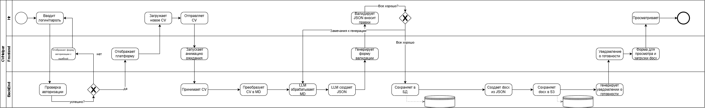
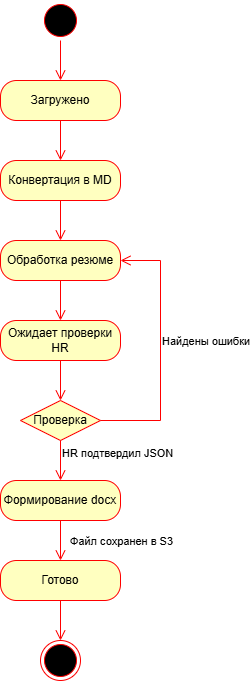
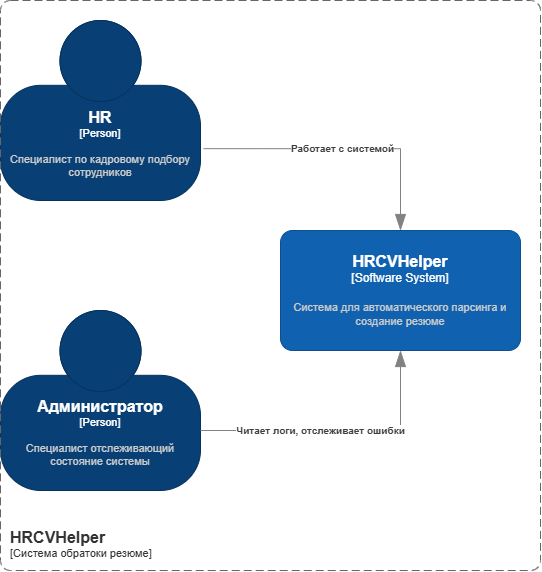
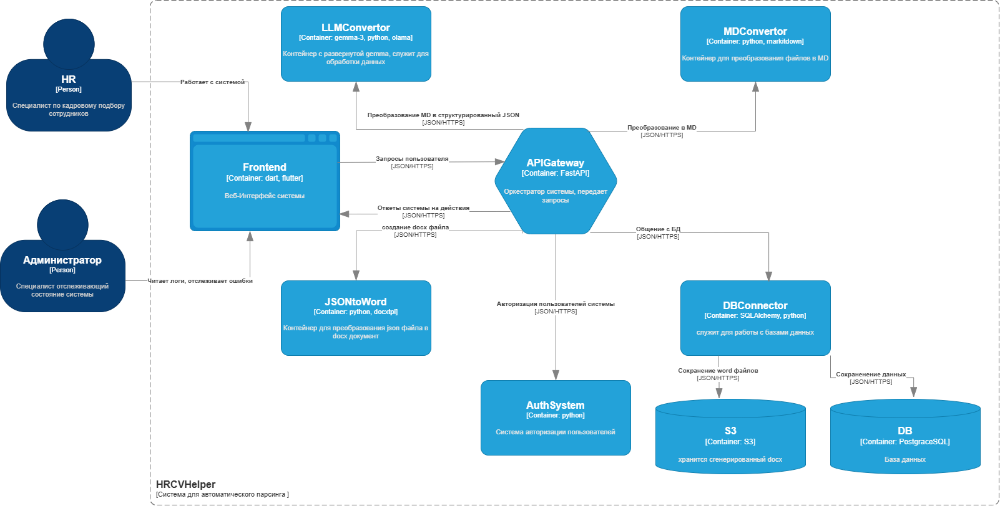
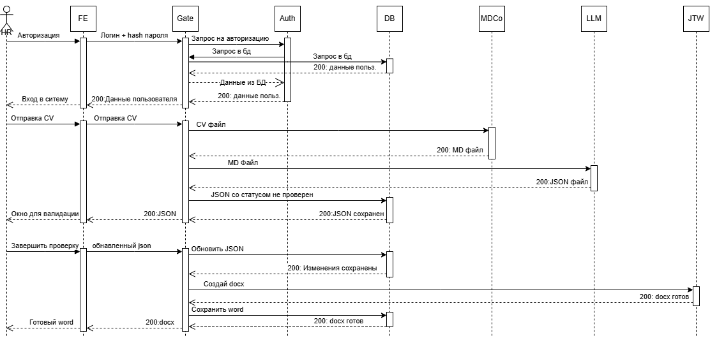
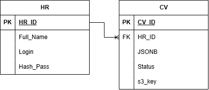

<div align="center">

# 📄 HRCVHelper
### Интеллектуальная система автоматизированного парсинга, структурирования и генерации резюме кандидатов


-8A2BE2?style=flat-square)


</div>

---

## 📋 Оглавление

1. [Введение в проект](#1-введение-в-проект)
   * [1.1. Назначение и цели проекта](#11-назначение-и-цели-проекта)
   * [1.2. Глоссарий (Термины и сокращения)](#12-глоссарий-термины-и-сокращения)
2. [Бизнес-процесс и Ролевая модель](#2-бизнес-процесс-и-ролевая-модель)
   * [2.1. Роли пользователей](#21-роли-пользователей)
   * [2.2. Описание бизнес-процесса (TO-BE) и BPMN 2.0](#22-описание-бизнес-процесса-to-be-и-bpmn-20)
   * [2.3. Жизненный цикл резюме (UML State Machine)](#23-жизненный-цикл-резюме-uml-state-machine)
3. [Функциональные требования](#3-функциональные-требования)
   * [3.1. Диаграмма прецедентов (UML Use Case)](#31-диаграмма-прецедентов-uml-use-case)
   * [3.2. Требования по контурам пользователей](#32-требования-по-контурам-пользователей)
   * [3.3. Спецификация ключевых сценариев (Use Cases)](#33-спецификация-ключевых-сценариев-use-cases)
4. [Архитектура системы (C4 Model)](#4-архитектура-системы-c4-model)
   * [4.1. Диаграммы C4 (Context & Containers)](#41-диаграммы-c4-context--containers)
   * [4.2. Перечень микросервисов и технологический стек](#42-перечень-микросервисов-и-технологический-стек)
   * [4.3. Структура репозитория](#43-структура-репозитория)
5. [Спецификация API и сценарии взаимодействия](#5-спецификация-api-и-сценарии-взаимодействия)
   * [5.1. Диаграмма последовательности (UML Sequence Diagram)](#51-диаграмма-последовательности-uml-sequence-diagram)
   * [5.2. Основные эндпоинты API Gateway](#52-основные-эндпоинты-api-gateway)
   * [5.3. Формат JSON-контракта резюме](#53-формат-json-контракта-резюме)
6. [Модель данных (База данных PostgreSQL)](#6-модель-данных-база-данных-postgresql)
   * [6.1. ER-диаграмма базы данных](#61-er-диаграмма-базы-данных)
   * [6.2. Словарь данных (Описание таблиц)](#62-словарь-данных-описание-таблиц)
7. [Нефункциональные требования (NFR)](#7-нефункциональные-требования-nfr)

---

## 1. Введение в проект

### 1.1. Назначение и цели проекта
Целью разработки системы **HRCVHelper** является автоматизация рутинных операций HR-специалиста на этапе переработки, унификации и оформления входящих резюме (CV) кандидатов.

> [!NOTE]
> **Ключевая ценность продукта:** Система берет на себя извлечение неструктурированного текста из исходных файлов резюме, преобразует его в строгую структуру с помощью локальной языковой модели (`Gemma-3`) и после быстрой валидации рекрутером автоматически генерирует корпоративный документ `.docx` с сохранением в объектное хранилище `S3`.

**Основные задачи системы:**
* 🎯 **Снижение затрат человеческого ресурса:** освобождение HR-специалистов от ручного копирования, переписывания и форматирования резюме под единый корпоративный стандарт.
* ⚖️ **Минимизация человеческого фактора:** исключение случайных опечаток, потери ключевых блоков опыта (проектов, стека, образования) и ошибок верстки при подготовке документа благодаря строгому JSON-контракту и шаблонизации.
* 🚀 **Сокращение времени отправки готовых резюме (Time-to-Send):** кратное ускорение цикла подготовки профиля кандидата от момента получения исходного файла до выгрузки готового `.docx`-документа.

### 1.2. Глоссарий (Термины и сокращения)

| Термин / Сокращение | Определение |
| :--- | :--- |
| **HR-специалист (HR)** | Основной внутренний пользователь системы, осуществляющий загрузку исходных резюме, проверку (валидацию) извлеченных JSON-данных и генерацию итоговых документов. |
| **Администратор** | Внутренний технический специалист, отслеживающий состояние системы, просматривающий системные логи и контролирующий отчеты о работоспособности (`health report`). |
| **CV (Curriculum Vitae)** | Резюме кандидата, содержащее информацию об опыте работы, проектах, навыках, образовании и личных данных. |
| **MD (Markdown)** | Облегченный язык разметки, используемый в системе как промежуточное текстовое представление резюме после конвертации из исходного файла перед подачей в `LLM`. |
| **LLM (Large Language Model)** | Локально развернутая большая языковая модель (`Gemma-3` под управлением `Ollama`), извлекающая сущности из Markdown-текста и формирующая структурированный JSON. |
| **Валидация JSON** | Этап проверки и корректировки HR-специалистом структурированных данных кандидата через веб-интерфейс перед финальной сборкой документа. |
| **S3** | Объектное файловое хранилище, предназначенное для надежного хранения сгенерированных итоговых `.docx`-резюме. |

---

## 2. Бизнес-процесс и Ролевая модель

### 2.1. Роли пользователей

| Роль | Контур доступа | Описание полномочий и взаимодействия с системой |
| :--- | :---: | :--- |
| 🧑‍💼 **HR-специалист (`HR`)** | Внутренний (`Web`) | Авторизуется в системе, загружает исходные файлы CV на обработку, проверяет и редактирует сгенерированную `LLM` структуру данных (JSON) в форме валидации, запускает формирование итогового `.docx`-файла и получает готовый документ. |
| 🛠️ **Администратор** | Технический | Контролирует техническое состояние контейнеров и микросервисов системы, читает логи, отслеживает ошибки и просматривает сводки работоспособности (`health report`). |

### 2.2. Описание бизнес-процесса (TO-BE) и BPMN 2.0

```text
[Авторизация HR] ──► [Загрузка файла CV] ──► [Конвертация в MD] ──► [Парсинг в LLM (Gemma-3)] ──► [Валидация JSON (HR)] ──► [Генерация .docx] ──► [Сохранение в S3 и выдача]
```

1. **Авторизация в системе:** HR-специалист открывает веб-интерфейс (`Frontend`) и вводит логин и пароль. `APIGateway` передает данные в модуль `AuthSystem`, который сверяет учетные данные с таблицей `HR` в базе данных через `DBConnector` и предоставляет доступ к рабочей области.
2. **Загрузка и конвертация резюме:** HR выбирает исходный файл резюме и отправляет его в систему. `APIGateway` передает файл в сервис `MDConvertor` (`MarkItDown`), который извлекает текст и преобразует его в чистую Markdown-разметку.
3. **Интеллектуальный парсинг через LLM:** Полученный MD-файл направляется в контейнер `LLMConvertor` (`Ollama` + `Gemma-3`). Языковая модель анализирует текст, выделяет проекты, навыки, образование, формирует краткое саммари (`pitch`) и возвращает структурированный JSON согласно заданной схеме. Черновик JSON сохраняется в БД со статусом `Ожидает проверки HR`.
4. **Проверка и валидация данных HR-специалистом:** Система отображает для HR окно валидации с полученными полями.
   * 🔄 *Если найдены ошибки или неточности:* HR вносит правки в структуру или возвращает резюме на доработку.
   * 🟢 *Если данные корректны:* HR подтверждает JSON, и обновленная структура фиксируется в базе данных.
5. **Генерация `.docx` и сохранение в S3:** После подтверждения JSON `APIGateway` вызывает сервис `JSONToWord` (`docxtpl`), который рендерит итоговый Word-документ по корпоративному шаблону. Готовый файл сохраняется в объектное хранилище `S3`, ссылка/ключ фиксируется в БД, статус переводится в `Готово`, а HR получает готовый документ.

#### 📊 Схема бизнес-процесса (BPMN 2.0)

> *Файл схемы в репозитории: `images/bpmn_process.png`*

---

### 2.3. Жизненный цикл резюме (UML State Machine)

Обрабатываемое резюме в системе проходит через строго определенный граф состояний (поле `Status` в таблице `CV`):

| № | Статус (`Status`) | Тип состояния | Условие перехода (Триггер) |
| :---: | :--- | :---: | :--- |
| **1** | `Загружено` | Начальное | HR-специалист загрузил исходный файл резюме в систему. |
| **2** | `Конвертация в MD` | Промежуточное | Файл передан в контейнер `MDConvertor` для преобразования в формат Markdown. |
| **3** | `Обработка резюме` | Промежуточное | MD-разметка передана в `LLMConvertor` для извлечения данных; либо возврат из проверки при обнаружении ошибок (`Найдены ошибки`). |
| **4** | `Ожидает проверки HR` | Промежуточное | `LLM` сформировала JSON, данные сохранены в БД и переданы в интерфейс для ревью. |
| **5** | `Формирование docx` | Промежуточное | HR проверил и подтвердил корректность данных (`HR подтвердил JSON`). |
| **6** | `Готово` | Терминальное 🟢 | Сгенерирован `.docx`-документ, файл успешно сохранен в хранилище `S3` (`Файл сохранен в S3`). |

#### 📊 Диаграмма состояний резюме (UML State Machine)

> *Файл схемы в репозитории: `images/state_diagram.png`*

---

## 3. Функциональные требования

### 3.1. Диаграмма прецедентов (UML Use Case)

> *Файл схемы в репозитории: `images/use_case.png`*

### 3.2. Требования по контурам пользователей

#### 🧑‍💼 Контур HR-специалиста (`ФТ-HR`)
* **ФТ-HR.1. Авторизация в системе:** Система должна обеспечивать аутентификацию HR-специалиста по логину и хэшу пароля перед предоставлением доступа к функциям парсинга.
* **ФТ-HR.2. Отправка и парсинг CV:** Система должна позволять загружать файлы резюме, автоматически конвертировать их в Markdown и извлекать структурированные данные в формате JSON с помощью локальной модели `Gemma-3`.
* **ФТ-HR.3. Проверка и редактирование JSON:** Система должна предоставлять веб-интерфейс для просмотра, валидации и ручной корректировки извлеченных полей резюме до генерации документа.
* **ФТ-HR.4. Создание и выгрузка `.docx`:** Система должна автоматически формировать итоговый файл `.docx` по шаблону на основе подтвержденного JSON, сохранять его в `S3` и отдавать HR-специалисту.

#### 🛠️ Контур Администратора (`ФТ-АДМ`)
* **ФТ-АДМ.1. Просмотр системных логов:** Система должна обеспечивать Администратору доступ к журналам событий и ошибок контейнеров для диагностики сбоев.
* **ФТ-АДМ.2. Мониторинг состояния (`health report`):** Система должна предоставлять сводную информацию о работоспособности и доступности внутренних модулей.

### 3.3. Спецификация ключевых сценариев (Use Cases)

<details>
<summary><b>▶️ UC-01: Авторизация пользователя в системе (Нажмите, чтобы развернуть)</b></summary>
<br>

| Параметр | Описание |
| :--- | :--- |
| **Актор** | HR-специалист |
| **Предусловие** | Учетная запись пользователя зарегистрирована в таблице `HR` базы данных. |
| **Основной сценарий** | 1. HR вводит логин и пароль в веб-интерфейсе (`FE`).<br>2. `FE` отправляет логин и хэш пароля в `APIGateway` (`Gate`).<br>3. `Gate` перенаправляет запрос на авторизацию в сервис `AuthSystem` (`Auth`).<br>4. `Auth` через шлюз выполняет запрос в базу данных (`DB`), получает данные пользователя (`200: данные польз.`) и подтверждает валидность учетных данных.<br>5. `Gate` возвращает `200: Данные пользователя` во фронтенд (`FE`), открывая доступ к системе. |
| **Альтернативные потоки** | **4а. Неверные учетные данные:** Если логин или хэш пароля не совпадают, система отклоняет вход и возвращает сообщение об ошибке авторизации. |

</details>

<details>
<summary><b>▶️ UC-02: Загрузка, автоматический парсинг и валидация CV (Нажмите, чтобы развернуть)</b></summary>
<br>

| Параметр | Описание |
| :--- | :--- |
| **Актор** | HR-специалист |
| **Предусловие** | HR-специалист успешно авторизован в системе (`UC-01`). |
| **Основной сценарий** | 1. HR выбирает файл резюме и инициирует отправку CV через `FE` $\rightarrow$ `Gate`.<br>2. `Gate` передает исходный CV-файл в сервис `MDConvertor` (`MDCo`) и получает в ответ сконвертированный Markdown (`200: MD файл`).<br>3. `Gate` направляет полученный MD-файл в сервис `LLMConvertor` (`LLM`).<br>4. `LLM` извлекает сущности по промпт-схеме и возвращает структурированный ответ (`200: JSON файл`).<br>5. `Gate` сохраняет JSON со статусом «не проверен» (`Ожидает проверки HR`) в `DB` (`200: JSON сохранен`).<br>6. `Gate` передает `200: JSON` в `FE`, который отображает для HR окно валидации. |

</details>

<details>
<summary><b>▶️ UC-03: Подтверждение JSON и генерация итогового документа .docx (Нажмите, чтобы развернуть)</b></summary>
<br>

| Параметр | Описание |
| :--- | :--- |
| **Актор** | HR-специалист |
| **Предусловие** | Резюме находится в статусе `Ожидает проверки HR`, открыто окно валидации. |
| **Основной сценарий** | 1. HR проверяет данные в окне валидации, при необходимости вносит правки и нажимает «Завершить проверку».<br>2. `FE` отправляет обновленный JSON в `Gate`.<br>3. `Gate` выполняет запрос в `DB` на обновление JSON и получает подтверждение (`200: Изменения сохранены`).<br>4. `Gate` отправляет команду «Создай docx» с JSON-данными в сервис `JSONToWord` (`JTW`) и получает готовый документ (`200: docx готов`).<br>5. `Gate` передает документ через слой работы с данными для сохранения в хранилище `S3` и фиксации ссылки в `DB`.<br>6. `Gate` возвращает `200: docx` во фронтенд (`FE`), предоставляя HR готовый Word-файл. |

</details>

---

## 4. Архитектура системы (C4 Model)

Система спроектирована как атомарный, самодостаточный программный комплекс на базе модульной контейнерной архитектуры с центральным оркестратором `APIGateway`. Взаимодействие клиентского приложения (`Frontend`) осуществляется исключительно через единый контракт `APIGateway`.

### 4.1. Диаграммы C4 (Context & Containers)

#### 🌐 Уровень 1: Контекстная диаграмма (C4 System Context)

> *Файл схемы в репозитории: `images/c4_context.png`*

#### 📦 Уровень 2: Диаграмма контейнеров (C4 Container Diagram)

> *Файл схемы в репозитории: `images/c4_container.png`*

### 4.2. Перечень микросервисов и технологический стек

| Контейнер (Код на схемах) | Технологический стек | Назначение и зона ответственности |
| :--- | :--- | :--- |
| **Frontend (`FE`)** | Dart, Flutter (Web) | Веб-интерфейс системы. Обеспечивает вход пользователей, загрузку файлов CV, форму интерактивной валидации JSON, выгрузку `.docx` и просмотр логов для Администратора. |
| **APIGateway (`Gate`)** | Python, FastAPI (`JSON/HTTPS`) | Центральный оркестратор системы. Принимает все запросы от `Frontend` и маршрутизирует вызовы между внутренними контейнерами. |
| **AuthSystem (`Auth`)** | Python | Система авторизации пользователей. Отвечает за проверку учетных данных и управление доступом к системе. |
| **MDConvertor (`MDCo`)** | Python, `MarkItDown` | Контейнер предварительной обработки файлов. Преобразует входящие документы резюме в чистую разметку Markdown (`MD`). |
| **LLMConvertor (`LLM`)** | Python, Ollama, `Gemma-3` | Контейнер с развернутой локальной языковой моделью `Gemma-3`. Выполняет семантический парсинг MD-текста в структурированный JSON. |
| **JSONToWord (`JTW`)** | Python, `docxtpl` | Сервис генерации документов. Преобразует подтвержденный JSON-файл в отформатированный `.docx`-документ по корпоративному шаблону. |
| **DBConnector** | Python, SQLAlchemy | Слой доступа к данным и хранилищам. Управляет транзакциями к реляционной БД PostgreSQL и отправкой готовых Word-файлов в объектное хранилище `S3`. |
| **DB** | PostgreSQL | Реляционная база данных для хранения профилей HR-специалистов, статусов резюме и структурированных `JSONB`-объектов. |
| **S3** | S3-совместимое хранилище | Объектное хранилище для сохранения и раздачи готовых `.docx`-файлов резюме. |

### 4.3. Структура репозитория

```text
hr-cv-helper/
├── docs/
│   ├── images/                      # Архитектурные и проектировочные схемы
│   │   ├── bpmn_process.png         # 1. Схема бизнес-процесса (BPMN 2.0)
│   │   ├── state_diagram.png        # 2. Диаграмма состояний (UML State Machine)
│   │   ├── use_case.png             # 3. Диаграмма прецедентов (UML Use Case)
│   │   ├── c4_context.png           # 4. C4 Уровень 1: Контекст системы
│   │   ├── c4_container.png         # 5. C4 Уровень 2: Контейнеры
│   │   ├── sequence_diagram.png     # 6. Диаграмма последовательности (UML Sequence)
│   │   └── er_database.png          # 7. ER-диаграмма БД
│   └── hr_cv_helper_docs.md         # Полная техническая документация
├── services/
│   ├── frontend/                    # Dart / Flutter Web UI (FE)
│   ├── api_gateway/                 # FastAPI Orchestrator (APIGateway)
│   ├── auth_system/                 # Сервис авторизации (AuthSystem)
│   ├── md_convertor/                # Конвертер файлов в Markdown (MarkItDown)
│   ├── llm_convertor/               # Интеграция с Ollama / Gemma-3 (LLMConvertor)
│   ├── json_to_word/                # Генератор .docx по шаблонам (docxtpl)
│   └── db_connector/                # Модуль работы с PostgreSQL (SQLAlchemy) и S3
├── docker-compose.yml               # Оркестрация контейнеров и инфраструктуры
├── .env.example                     # Шаблон переменных окружения
└── README.md                        # Описание проекта
```

---

## 5. Спецификация API и сценарии взаимодействия

Взаимодействие между клиентским приложением и внутренними сервисами осуществляется через центральный шлюз `APIGateway` по протоколу `JSON/HTTPS`.

### 5.1. Диаграмма последовательности (UML Sequence Diagram)

> *Файл схемы в репозитории: `images/sequence_diagram.png`*

### 5.2. Основные эндпоинты `APIGateway`

#### 🧑‍💼 Контур HR-специалиста

| Метод | Эндпоинт | Внутренний маршрут вызовов | Описание и возвращаемый результат |
| :---: | :--- | :--- | :--- |
| `POST` | `/api/v1/auth/login` | `Gate` $\rightarrow$ `Auth` $\rightarrow$ `DB` | Авторизация пользователя по логину и хэшу пароля. Возвращает профиль пользователя и токен сессии (`200 OK`). |
| `POST` | `/api/v1/cv/upload` | `Gate` $\rightarrow$ `MDCo` $\rightarrow$ `LLM` $\rightarrow$ `DB` | Загрузка исходного файла CV, конвертация в MD, извлечение структуры в `LLM`, сохранение черновика в БД и возврат JSON для валидации (`200 OK`). |
| `PUT` | `/api/v1/cv/{cv_id}/validate` | `Gate` $\rightarrow$ `DB` $\rightarrow$ `JTW` $\rightarrow$ `S3` / `DB` | Сохранение проверенного/обновленного JSON в БД, генерация `.docx`-файла в `JSONToWord`, сохранение в `S3` и возврат готового документа (`200 OK`). |
| `GET` | `/api/v1/cv/{cv_id}` | `Gate` $\rightarrow$ `DB` | Получение текущих JSON-данных, статуса резюме и ссылки на готовый `.docx`-файл (`200 OK`). |

#### 🛠️ Контур Администратора

| Метод | Эндпоинт | Внутренний маршрут вызовов | Описание и возвращаемый результат |
| :---: | :--- | :--- | :--- |
| `GET` | `/api/v1/admin/logs` | `Gate` $\rightarrow$ Внутренние сервисы | Получение системных логов работы контейнеров для отслеживания ошибок (`200 OK`). |
| `GET` | `/api/v1/admin/health` | `Gate` $\rightarrow$ Внутренние сервисы | Сбор и возврат отчета о состоянии компонентов системы (`health report`, `200 OK`). |

### 5.3. Формат JSON-контракта резюме
Поле `JSONB` в таблице `CV` и контракт обмена между `LLMConvertor`, `Frontend` и `JSONToWord` имеют следующую структуру:

```json
{
  "fio": "ФИО",
  "vacancy": "Вакансия",
  "total_year_work": "Общее время работы по этой профессии X ЛЕТ Y МЕСЯЦЕВ",
  "project_backround": "Краткое описание отраслей работы, общепринятые, условный Финтех, банковская среда и тд.",
  "pitch": "рассказ о себе от первого лица, без 'Я' кратко 3 - 5 предложений",
  "skills_and_tools": [],
  "education": [
    {
      "type": "Вид уч. заведения, например Высшее:",
      "institution": "название института",
      "speciality": "специальность",
      "year": "год поступления - год выпуска"
    }
  ],
  "advanced_training": [
    {
      "name": "Название курса",
      "year": "год прохождения"
    }
  ],
  "languages": "Знание языков, если нет то указывать Английский на уровне A2",
  "citizenship_location": "страна проживания, город",
  "employment": "занятость условно - полная занятость, удаленная работа",
  "status": "готовность к переезду или командировкам например - Готов к переезду, готов к редким командировкам",
  "projects": [
    {
      "place_time_raw": "название компании",
      "period": "Время работы в компании формат - XXXX год YY месяц - ZZZZ год VV месяц / CC ЛЕТ NN МЕСЯЦЕВ",
      "role_in_project": "занимаемая роль на проекте",
      "task_on_project": [
        "список задач выполненных на проекте, если мало информации о задачах то необходимо их вычленить из текста описания работ по проекту"
      ],
      "achievements_in_project": [
        "список достижений на проекте"
      ],
      "skills_tools_in_project": "использованные знания и инструменты, исходя из описания проекта, описанного стека, и решаемых задач"
    }
  ]
}
```

---

## 6. Модель данных (База данных PostgreSQL)

Хранение данных осуществляется в реляционной СУБД **PostgreSQL** с использованием типа `JSONB` для хранения древовидной структуры распарсенного резюме и объектного хранилища **S3** для физических файлов `.docx`.

### 6.1. ER-диаграмма базы данных

> *Файл схемы в репозитории: `images/er_database.png`*

### 6.2. Словарь данных (Описание таблиц)

#### 1. Таблица `HR` (Пользователи / HR-специалисты)
| Поле | Тип данных | Ограничения | Описание |
| :--- | :--- | :--- | :--- |
| `HR_ID` | `SERIAL / INT` | `PK` | Уникальный идентификатор HR-специалиста. |
| `Full_Name` | `VARCHAR(255)` | `NOT NULL` | ФИО сотрудника. |
| `Login` | `VARCHAR(128)` | `UNIQUE, NOT NULL` | Уникальный логин для входа в систему. |
| `Hash_Pass` | `VARCHAR(255)` | `NOT NULL` | Хэш пароля пользователя. |

#### 2. Таблица `CV` (Обрабатываемые резюме)
| Поле | Тип данных | Ограничения | Описание |
| :--- | :--- | :--- | :--- |
| `CV_ID` | `SERIAL / INT` | `PK` | Уникальный идентификатор записи резюме. |
| `HR_ID` | `INT` | `FK -> HR(HR_ID)` | Ссылка на HR-специалиста, загрузившего резюме (связь `1:N`). |
| `JSONB` | `JSONB` | `NOT NULL` | Структурированные данные резюме кандидата (сформированные `LLM` и проверенные HR). |
| `Status` | `VARCHAR(64)` | `NOT NULL` | Текущий статус жизненного цикла резюме согласно State Machine. |
| `Docx` | `TEXT / VARCHAR` | `NULL` | Ссылка / ключ к сгенерированному итоговому `.docx`-файлу в хранилище `S3`. |

---

## 7. Нефункциональные требования (NFR)

> [!IMPORTANT]
> **Соблюдение 152-ФЗ (Безопасность персональных данных):** Все операции по парсингу и структурированию резюме кандидатов выполняются строго во внутреннем контуре с использованием локально развернутой модели `Gemma-3` (`Ollama`) без передачи персональных данных во внешние облачные LLM-сервисы.

### 7.1. Безопасность и архитектура
* **Единая точка входа (`API-First`):** Клиентское приложение (`Frontend`) взаимодействует исключительно с `APIGateway` по протоколу `HTTPS`. Прямой доступ из внешнего контура к базе данных, `S3` или внутренним контейнерам (`MDConvertor`, `LLMConvertor`, `JSONToWord`) закрыт.
* **Атомарность и независимость:** Система спроектирована как полностью автономный инструмент, готовый как к самостоятельной эксплуатации, так и к последующему подключению в единую экосистему HR-инструментов через внешний шлюз.
* **Защита учетных данных:** Пароли пользователей передаются и хранятся исключительно в хэшированном виде (`Hash_Pass`).

### 7.2. Надежность и контроль качества
* **Обязательная валидация человеком (Human-in-the-Loop):** Финальная генерация документа `.docx` блокируется до тех пор, пока HR-специалист явно не подтвердит валидность извлеченного JSON-профиля.
* **Наблюдаемость (Observability):** Контейнеры системы обеспечивают сбор логов и метрик состояния (`health report`) для оперативного мониторинга Администратором.